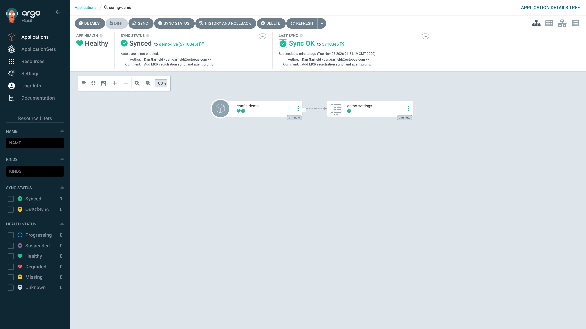
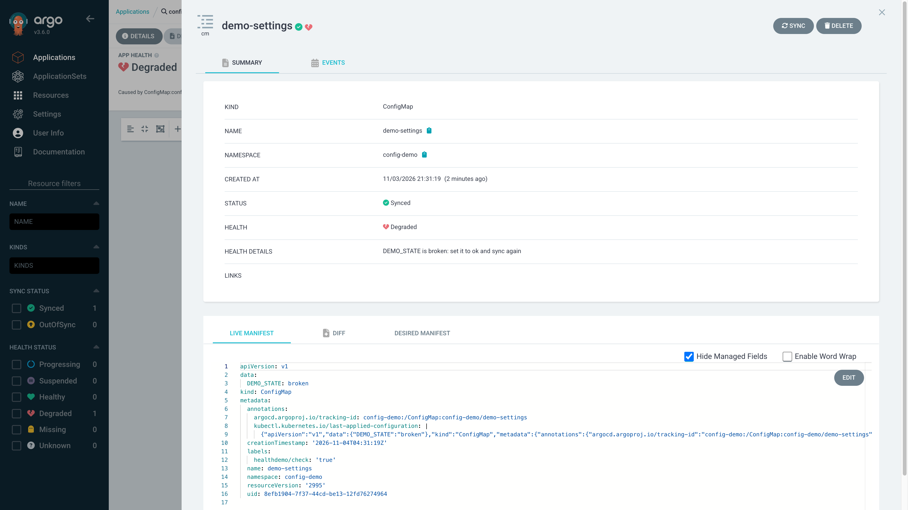
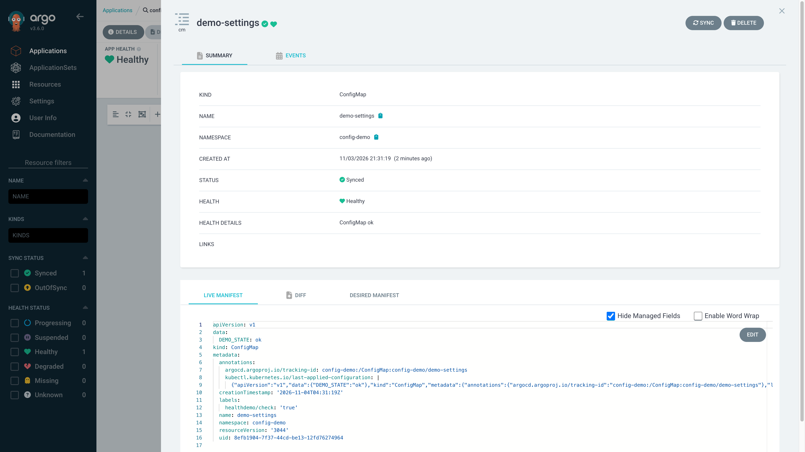
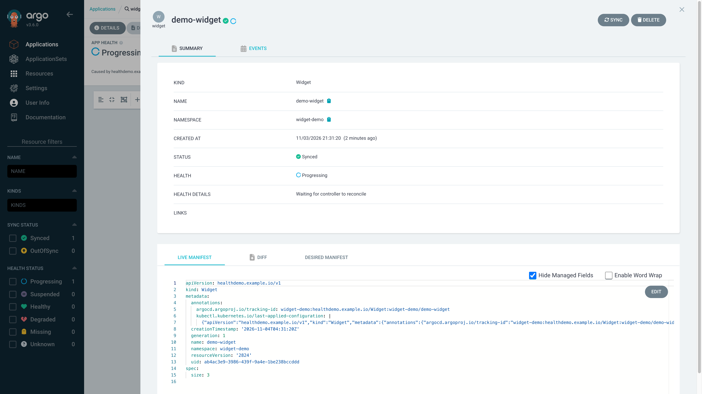
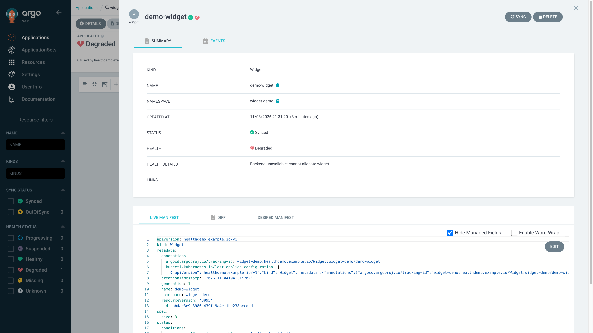
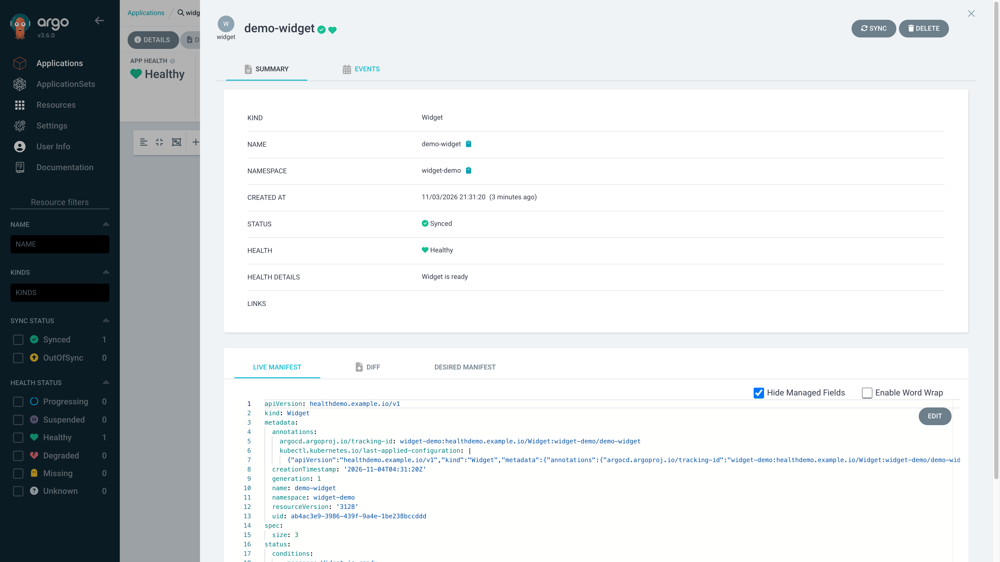
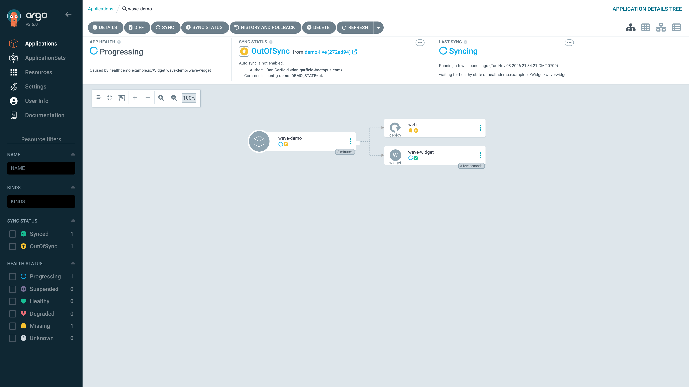
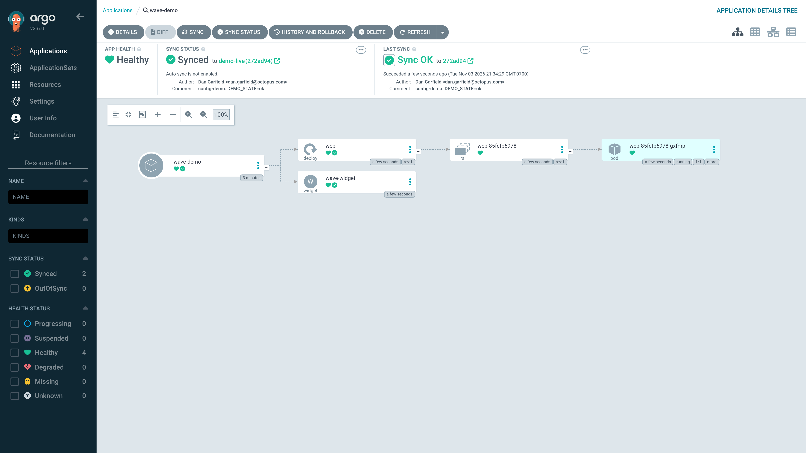
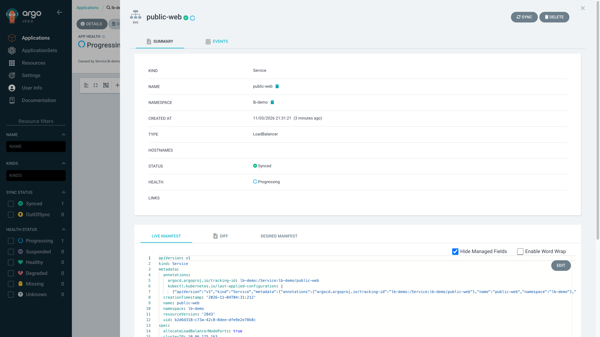
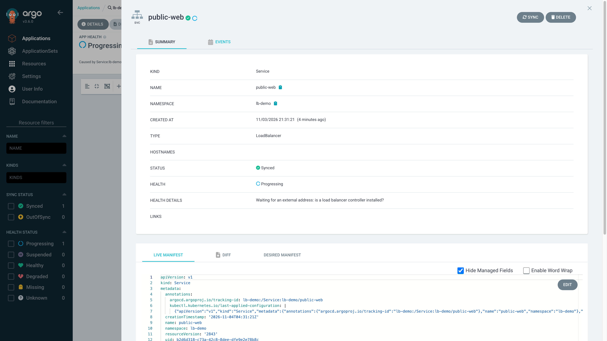

# Runbook: "Argo CD's health checks are your secret weapon to CD nirvana"

- **Argo CD:** v3.6.0 (server, pinned in `manifests/argocd-install-v3.6.0.yaml`). The CLI used for
  the runs below is the locally installed v3.5.3 (downloading the v3.6.0 binary was blocked in the
  build session). The same Lua produced the same states on the v3.6.0 server in every live demo.
- **Cluster:** kind `healthdemo`, `kindest/node:v1.36.4` (pinned by digest in `kind/cluster.yaml`).
- **Captured:** 2026-11-04 from real runs (`scripts/run-demos.sh` writes `demo/out/*.txt`; the
  blocks below are copied from those files).
- **Verified:** `scripts/reset.sh` → `scripts/run-demos.sh` → `scripts/test-health.sh`, twice in a
  row, both clean (`demo/out/full-passes.txt`): reset 12–14 s, a full pass about 40 s.

## Before the talk

```
kind create cluster --config kind/cluster.yaml        # only if the cluster is gone
scripts/load-images.sh                                 # pre-load every image (offline safety)
scripts/port-forward.sh                                # https://localhost:8080
scripts/reset.sh                                       # opening state, ~13 s
scripts/preflight.sh                                   # every line must say OK
```

Opening state after `reset.sh`: no custom health checks in `argocd-cm`; `demo-live` == `demo-build`;
`config-demo`, `widget-demo`, `lb-demo` synced; `wave-demo` deliberately OutOfSync.

```
NAME                STATUS     HEALTH
argocd/config-demo  Synced     Healthy
argocd/lb-demo      Synced     Progressing
argocd/wave-demo    OutOfSync  Missing
argocd/widget-demo  Synced     Healthy
reset done in 12s
```

`scripts/health.sh <app>` prints the per-resource health **message**, which `argocd app get`'s
MESSAGE column does not (that column shows the sync result).

> **Wifi:** all images are loaded into kind, so the cluster runs offline. But the apps' Git source is
> the private GitHub repo (branch `demo-live`). Demo A and Demo E push to it, and every sync
> fetches from it. **Without internet, syncs fail.** Tether your phone as a backup.

---

## Demo A: ConfigMap check (90 seconds)

```
scripts/apply-config.sh ConfigMap
scripts/set-demo-state.sh broken          # commit DEMO_STATE: broken to demo-live
argocd app sync config-demo
scripts/health.sh config-demo
scripts/set-demo-state.sh ok
argocd app sync config-demo
scripts/health.sh config-demo
```

Real output:

```
$ scripts/health.sh config-demo
app config-demo: Synced / Degraded
  ConfigMap/demo-settings: Degraded - DEMO_STATE is broken: set it to ok and sync again
$ set-demo-state.sh ok
pushed DEMO_STATE=ok to demo-live (24af001)
$ scripts/health.sh config-demo
app config-demo: Synced / Healthy
  ConfigMap/demo-settings: Healthy - ConfigMap ok
```





**Talking point:** "Synced" only means Git matches the cluster. Ten lines of Lua turn a value that is
wrong but valid into a red Degraded status with a message telling you how to fix it. The label guard means
no other ConfigMap in the cluster is affected.

**Watch for:** the check only fires on ConfigMaps labelled `healthdemo/check: "true"`. If the app
stays Healthy, run `scripts/apply-config.sh ConfigMap` again and refresh. In the UI, click the
`demo-settings` node: the message is in **HEALTH DETAILS**.

---

## Demo B: custom resource with observedGeneration

```
scripts/health.sh widget-demo                              # no check yet: Widget has no health
scripts/apply-config.sh healthdemo.example.io_Widget
scripts/health.sh widget-demo refresh
scripts/set-widget-status.sh demo-widget failed
scripts/health.sh widget-demo
scripts/set-widget-status.sh demo-widget ready
scripts/health.sh widget-demo
```

Real output:

```
app widget-demo: Synced / Healthy
  Widget/demo-widget: - -
$ apply-config.sh healthdemo.example.io_Widget
app widget-demo: Synced / Progressing
  Widget/demo-widget: Progressing - Waiting for controller to reconcile
$ set-widget-status.sh demo-widget failed
app widget-demo: Synced / Degraded
  Widget/demo-widget: Degraded - Backend unavailable: cannot allocate widget
$ set-widget-status.sh demo-widget ready
app widget-demo: Synced / Healthy
  Widget/demo-widget: Healthy - Widget is ready
```





**Talking point:** without a check, Argo CD calls your CRD "Healthy" because it has no opinion
about it. That's the dangerous default. The check reads `observedGeneration` and the Ready
condition the same way a controller author intended, and passes the controller's own message through.

**Watch for:** `set-widget-status.sh reconciling` sets `observedGeneration` one behind, which shows
the "Controller has not observed generation N" branch if someone asks.

---

## Demo C: sync-wave gate

```
scripts/apply-config.sh healthdemo.example.io_Widget       # no-op if Demo B ran
argocd app sync wave-demo --async
scripts/health.sh wave-demo                                # operation Running, web Missing
scripts/set-widget-status.sh wave-widget ready
argocd app wait wave-demo --sync --health
scripts/health.sh wave-demo
```

Real output:

```
app wave-demo: OutOfSync / Progressing
  operation: Running - waiting for healthy state of healthdemo.example.io/Widget/wave-widget
  Deployment/web: Missing -
  Widget/wave-widget: Progressing - Waiting for controller to reconcile
$ set-widget-status.sh wave-widget ready
app wave-demo: Synced / Healthy
  operation: Succeeded - successfully synced (all tasks run)
  Deployment/web: Healthy -
  Widget/wave-widget: Healthy - Widget is ready
TIMING: wave 1 held for 8s (until the Widget turned Ready); wave 1 done 1s after Ready
```




**Talking point:** the wait is as long as the dependency takes, not a sleep. Here it held for 8 s
because that's when I ran the script. Once the Widget turned Ready, wave 1 was applied and Healthy in
about **1 second**. The UI's LAST SYNC panel says exactly what it is waiting on.

**Watch for:** `wave-demo` must start OutOfSync (reset leaves it that way). If the Widget check isn't
applied, wave 0 is "Healthy" immediately and there is no wait to show.

---

## Demo D: stuck load balancer

```
scripts/health.sh lb-demo                    # built-in Go check: Progressing, empty message
kubectl -n lb-demo get svc public-web        # EXTERNAL-IP <pending>
scripts/apply-config.sh Service
scripts/health.sh lb-demo refresh
```

Real output:

```
app lb-demo: Synced / Progressing
  Service/public-web: Progressing -
NAME         TYPE           CLUSTER-IP     EXTERNAL-IP   PORT(S)        AGE
public-web   LoadBalancer   10.96.126.81   <pending>     80:32178/TCP   22s
$ apply-config.sh Service
app lb-demo: Synced / Progressing
  Service/public-web: Progressing - Waiting for an external address: is a load balancer controller installed?
```




**Talking point:** you can replace a built-in check. Same status, but now Progressing comes with a
hint you can act on. Other Service types stay Healthy, as with the built-in check.

**Watch for:** the key is `resource.customizations.health.Service`. Core-group kinds have **no group
prefix**. `v1_Service` (as first planned) is silently ignored: the app stays Progressing with an empty
message, which is exactly what we caught and fixed. The appearance of the new message is the proof
the override is active.

---

## Demo E: agent fixes config-demo through the Argo CD MCP server

Prompt and setup: [`agent-prompt.md`](agent-prompt.md). Server: `argoproj-labs/mcp-for-argocd`,
npm `argocd-mcp@0.9.0`, run with `npx argocd-mcp@0.9.0 stdio`, env `ARGOCD_BASE_URL`,
`ARGOCD_API_TOKEN`, plus `NODE_TLS_REJECT_UNAUTHORIZED=0` for the self-signed certificate.
Registered by `scripts/register-mcp.sh` (local scope, token read from `.demo-credentials`).

**Status: run end to end once (2026-11-04), no help needed, nothing blocked.** Starting state:
`scripts/reset.sh`, `apply-config.sh ConfigMap`, `set-demo-state.sh broken`, sync. What the agent did:

1. `get_application_resource_tree config-demo` (MCP, as `demo-agent`):
   `ConfigMap demo-settings: Degraded - "DEMO_STATE is broken: set it to ok and sync again"`.
   `get_application` returns the same message, plus app health "Caused by ConfigMap:config-demo/demo-settings".
2. Read `apps/config-demo/configmap.yaml` on `origin/demo-live` (`DEMO_STATE: broken`), changed it to
   `ok`, committed unsigned, pushed to `demo-live` → `b68726e`.
3. `sync_application config-demo` (MCP): accepted, `initiatedBy: demo-agent`, revision `b68726e`.
4. `get_application_resource_tree` again: `demo-settings: Healthy - "ConfigMap ok"`.

Confirmed from the CLI (`demo/out/E-agent-run.txt`):

```
app config-demo: Synced / Healthy
  operation: Succeeded - successfully synced (all tasks run)
  ConfigMap/demo-settings: Healthy - ConfigMap ok
$ argocd app history config-demo
1       2026-11-04 06:28:46 -0700 MST  demo-live (a188734)    <- scripted broken state
2       2026-11-04 06:29:10 -0700 MST  demo-live (b68726e)    <- agent's fix
```

Diagnose to Healthy took about 30 s.

**Talking point:** the health message is the interface. Because the Lua check says *what's wrong
and how to fix it*, an agent holding a read-and-sync-only token can close the loop with nothing
but the MCP server and Git. The same message helps the human on call.

**Rehearsal notes:**
- `get_application` returns the full object including `managedFields` (very long).
  `get_application_resource_tree` is the short answer, so it's the better call to show on screen.
- The run passed `applicationNamespace: argocd` explicitly on every call.

Permission path the MCP server uses, verified separately, with the `demo-agent` token
(`demo/out/E-permissions.txt`):

```
GET    config-demo      -> 200
POST   config-demo/sync -> 200
DELETE config-demo      -> 403   (expect 403)
```

**Watch for:**
- **Git write path:** the agent pushes through the shell's Git credentials. Start Claude Code from
  a shell where `GIT_TOKEN` and `GIT_ASKPASS=$PWD/scripts/git-askpass.sh` are exported, or the push
  fails. Commits to `demo-live` are unsigned on purpose, so there's no 1Password prompt on stage.
- **RBAC:** `demo-agent` can `get` and `sync` in `default/*` only (`argocd-config/rbac-cm-patch.yaml`).
  The resource-tree and manifest calls fall under `applications, get`. If a call is denied, check the
  app's project is `default`. Do not grant `update`/`delete`.

---

## Offline tests

```
scripts/test-health.sh
```

12 fixtures (`fixtures/<name>.yaml` + `.expected`: line 1 the status, optional line 2 text the
message must contain), including one with no `status` per check. Runs with `KUBECONFIG=/dev/null`.
Exits non-zero on any mismatch (verified by breaking an expectation). The ConfigMap and Service
checks have no Degraded state by design, so they have no Degraded fixture.
